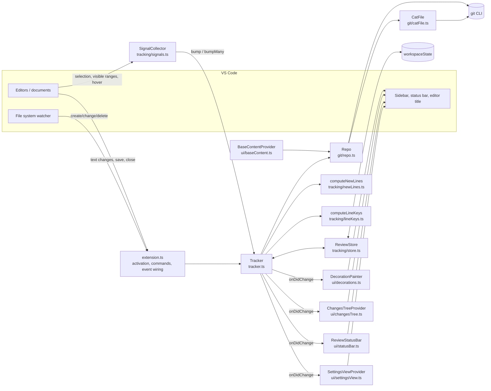

# Architecture

Anti-Vibe Coder is a single VS Code extension bundle (`dist/extension.js`, built by esbuild from `src/extension.ts`). It has no server, no network access, and one runtime dependency (`diff`). Everything runs in the extension host.

## Components



| Module | Responsibility |
| --- | --- |
| `extension.ts` | Creates every component, registers commands, menus' handlers and the event wiring below. Holds small helpers (find next unreviewed line, base-branch quick pick). |
| `tracker.ts` | The central model. Owns the `Repo`s, the per-file "which lines are new" state, file stats and the change event. Every write to scores goes through it. |
| `git/repo.ts` | One git repository: branch, base ref, merge-base, the set of changed files, base content per file. Pure Node (no `vscode` import), so it is tested against real temporary repos. |
| `git/catFile.ts` | A long-lived `git cat-file --batch` process per repo and its stream parser. |
| `git/git.ts` | `execFile('git', …)` wrapper. |
| `tracking/lineKeys.ts` | Content-based line identity (hash of the trimmed text + occurrence index). |
| `tracking/newLines.ts` | Which lines of the current file are new compared to the base (anchored line diff). |
| `tracking/scoring.ts` | Score maps (line key → 0..1), summaries, categories, colour buckets. |
| `tracking/focus.ts` | The "reading band": which visible lines count as being read. |
| `tracking/signals.ts` | Turns editor activity into score increments, once per second and on selection events. |
| `tracking/store.ts` | Keeps scores in memory, persists them to `workspaceState` with a debounce. |
| `ui/decorations.ts` | Paints the blue → pink gradient with 11 decoration types. |
| `ui/changesTree.ts` | The *Overview* tree: files grouped as Unseen / Partially seen / Fully seen. |
| `ui/statusBar.ts` | `$(eye) 42% reviewed`. |
| `ui/settingsView.ts` | The *Settings* webview (sliders, thresholds, colours, per-branch base). |
| `ui/baseContent.ts` | `antivibe-base:` documents with the merge-base version of a file, for diff editors. |
| `settingsIO.ts` | Export / import / reset of the shareable settings. |
| `config.ts` | Reads the `antiVibe.*` settings into a typed `Config`. |
| `util/limit.ts` | A tiny concurrency limiter. |

## Core data model

For each changed file the tracker builds a **`FileState`**:

- `keys: string[]` is the identity of each line: `hash(trimmed text)`, with `#n` appended for the n-th duplicate (see [ADR 0001](decisions/0001-content-keyed-line-identity.md)).
- `isNew: Uint8Array` is 1 for each line that is added or modified compared to the merge-base ([ADR 0002](decisions/0002-compare-against-merge-base.md), [ADR 0012](decisions/0012-fast-line-diff.md)).
- `tag` is the version it was computed for: `doc:<version>` for an open document, `disk:<mtime>:<size>` for a file read from disk.

Scores live separately in the **`ReviewStore`**: per `storeKey` (`<normRoot>::<branch>`), per repo-relative path, a `Map<lineKey, score>` with scores in [0, 1] ([ADR 0003](decisions/0003-score-model.md)). Because scores are keyed by content, a line keeps its score when lines are inserted above it, and a rewritten line starts at 0.

A line's colour is `bucket = round(min(1, score / reviewedThreshold) × 10)`, one of 11 decoration types ([ADR 0009](decisions/0009-bucketed-decorations.md)).

**`FileStats`** (`progress: { total, sum, reviewed }`) summarises a file for the tree and the status bar. **`Totals`** sums them over the branch.

## Data flow

### Activation

1. `activate` creates the `Tracker` (with `context.workspaceState`), the painter, the tree, the settings view, the `SignalCollector` and the status bar.
2. `Tracker.refresh()` finds the repo of each workspace folder (`git rev-parse --show-toplevel`, cached per folder), then calls `Repo.refresh()` for each repo:
   - `rev-parse --abbrev-ref HEAD` gives the branch.
   - The base ref is the per-branch choice, then the setting, then auto-detect with one `for-each-ref` call ([ADR 0008](decisions/0008-per-branch-base.md)).
   - `merge-base HEAD <base>`.
   - `diff --name-only <merge-base>` and `ls-files --others --exclude-standard` run in parallel and give the changed set.
3. `recomputeAllStats` builds a `FileState` for every changed file. Open documents use their text and closed files are read from disk, 16 at a time. Base content comes through `cat-file`.
4. A change event with `docs: 'all'` paints everything.

### Reading (once per second)

```
SignalCollector.tick
  → for each visible editor with a FileState:
      viewport band lines (+ cursor / selection lines if active) → deltas
  → Tracker.bumpMany(doc, deltas)
      → bumpScore on the ScoreMap, store.markDirty, statsDirty += file
      → fireSoon(uriKey)                       (throttled: one event per 60 ms)
  → onDidChange { docs: {uriKey} }
      → DecorationPainter repaints that editor, only the buckets that changed
      → status bar / view title read Tracker.getTotals()
      → tree checks its signature after 1 s and fires only if something it shows changed
```

### A keystroke

```
onDidChangeTextDocument
  → Tracker.onDocumentChanged
      → line keys of the new version (computed once, cached in keysCache)
      → if it looks like the user typing: carry the edited line's score to its new key, + typing weight
      → fireSoon(uriKey)
  → painter → Tracker.getDocState(doc): new version → computeNewLines(base lines, current lines) → repaint
```

### A file changes on disk

`FileSystemWatcher('**/*')` → `Tracker.onFileEvent` decides what the event costs ([ADR 0011](decisions/0011-targeted-invalidation.md)):

| Event | Action |
| --- | --- |
| `.git/HEAD`, `.git/refs/**`, `.git/packed-refs`, `.git/index`, `.git/info/exclude` | full refresh (debounced 1.5 s) |
| anything else inside `.git` | ignored |
| any event while the repo is in an error state | slow refresh (5 s), to recover |
| changed file, created or changed, not open | re-read just that file (batched, 0.5 s, max 16 at a time) |
| changed file, open in an editor | ignored (document events cover it) |
| delete of a changed file, or of a folder containing one | full refresh |
| other file created or changed | batched `git check-ignore`; full refresh only if some path is not ignored |
| other delete | ignored (deletions are never shown) |

Saving a document feeds the same path. Focusing the window also schedules a full refresh, to catch commits and edits made outside VS Code.

## Event wiring

| Source | Handler | Effect |
| --- | --- | --- |
| `workspace.onDidChangeTextDocument` | `Tracker.onDocumentChanged`, `SignalCollector` (activity) | keys, typing transfer, repaint |
| `workspace.onDidSaveTextDocument` | `Tracker.pruneDocument`, `Tracker.onFileEvent` | drop scores of vanished lines; maybe join the diff |
| `workspace.onDidCloseTextDocument` | `Tracker.forgetDocument` | drop per-document caches |
| `workspace.onDidChangeWorkspaceFolders` | `Tracker.workspaceFoldersChanged` | rediscover repos |
| `workspace.onDidChangeConfiguration` | `Tracker.reloadConfig`, `DecorationPainter.recreate`, settings view | see "Invalidation" |
| `window.onDidChangeWindowState` (focused) | `Tracker.scheduleRefresh(300)`, activity | catch external changes |
| `window.onDidChangeTextEditorSelection` | `SignalCollector` | activity; instant cursor/selection scoring |
| `window.onDidChangeTextEditorVisibleRanges` | `SignalCollector` | activity; resets the "stable viewport" timer |
| `window.onDidChangeVisibleTextEditors` | `DecorationPainter` | paint newly visible editors |
| `languages.registerHoverProvider({ scheme: 'file' })` | `SignalCollector` | hover score; never returns a hover |
| `FileSystemWatcher('**/*')` | `Tracker.onFileEvent` | triage (table above) |
| `Tracker.onDidChange` | painter, tree, status bar, view title, settings view, `antiVibe.hasRepo` context | UI updates |

### The change event

`Tracker.onDidChange` fires `{ docs: Set<uriKey> | 'all' }`, throttled to one event per 60 ms with the document sets merged:

- `'all'` after a refresh, a reset, a config change, or when the caller can't tell which document changed.
- A set of `uri.toString()` keys after score changes or edits in those documents.
- An empty set when only stats changed (a file re-read from disk). Nothing needs repainting, but the totals did change.

Stats marked dirty are recomputed and the totals summed **once** per event, in `fireNow`, before listeners run.

## Caching and invalidation

| Cache | Key | Valid while | Dropped when |
| --- | --- | --- | --- |
| `Tracker.folderRoots` | workspace folder path | always | workspace folders change; folders without a repo are re-checked on every refresh |
| `Repo.baseCache` | repo-relative path | merge-base unchanged | merge-base changes |
| `Tracker.keysCache` | document URI | same document version | document closed |
| `Tracker.docStates` | document URI | same document version and repo | repo's base changes; ignore-whitespace setting changes; document closed |
| `Tracker.diskStates` | repo + path | same merge-base, mtime and size | repo's base changes; file leaves the diff; ignore-whitespace setting changes |
| `Tracker.stats` | repo + path | recomputed when marked dirty | file leaves the diff; base changes |
| `DecorationPainter.painted` | `TextEditor` | same document version | editor hidden and shown again; colours recreated |
| `CatFile` process | repo | 60 s since the last read | idle timeout, crash (restarted on next read), repo disposed |

"Base changes" means a different branch, base ref, merge-base or readiness, as reported by `Repo.refresh()` in `baseChanged`. When only the *set* of changed files changes (a new file, a reverted file), nothing is invalidated. New files get state, and files that left the diff are dropped.

Settings:

- `baseBranch` and `ignoreWhitespaceOnlyLines` drop all file states and refresh.
- `reviewedThreshold` recomputes all stats.
- Colours and `hideWhenFullyReviewed` recreate the decoration types.
- Anything else just fires a change event.

## Persistence

All state is local to the machine ([ADR 0006](decisions/0006-local-storage.md)).

| Where | Key | Value |
| --- | --- | --- |
| `workspaceState` | `antiVibe.v1:<normRoot>::<branch>` | `{ "<repo-relative path>": { "<lineKey>": score } }`, scores rounded to 3 decimals; files without scores are omitted |
| `workspaceState` | `antiVibe.branchBases` | `{ "<normRoot>::<branch>": "<base ref>" }` |
| `globalState` | `antiVibe.decorationsEnabled` | `boolean` (also mirrored to the `antiVibe.decorationsEnabled` context key) |
| settings | `antiVibe.*` | see [FEATURES.md](FEATURES.md#settings) |

`normRoot` is the absolute repo root, lower-cased on Windows. The store writes changed branches 3 s after the last change and on deactivate. Scores of lines that no longer exist are pruned when a file is saved or re-read from disk.

## Context keys

| Key | Meaning |
| --- | --- |
| `antiVibe.decorationsEnabled` | Colours shown; switches the eye button between *Hide* and *Show*. |
| `antiVibe.hasRepo` | At least one repo is tracked; shows the eye button in the editor title. |
